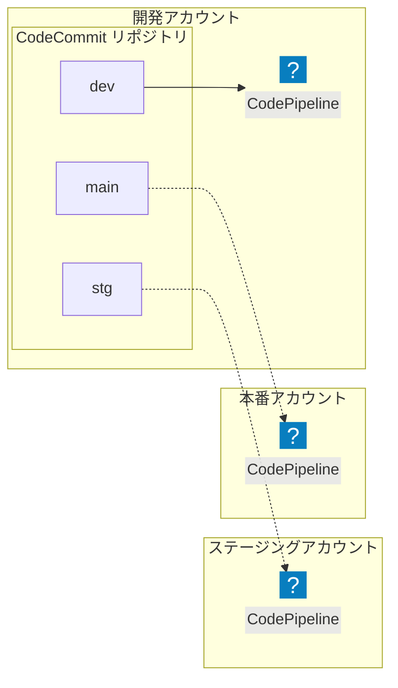

# AWS CI/CD構成図

開発アカウントにCodeCommitを1つ置きます。各アカウントのCodePipelineは、対応するブランチを読み取ります。

## CodeCommitと各アカウントのCodePipeline

矢印はソースコードの流れです。実線は同一アカウント内、破線はアカウントをまたぐ取得を示します。

## ブランチとアカウントの対応

| ブランチ | CodeCommitの配置先 | CodePipelineの配置先 |
| --- | --- | --- |
| `dev` | 開発アカウント | 開発アカウント |
| `stg` | 開発アカウント | ステージングアカウント |
| `main` | 開発アカウント | 本番アカウント |

ステージングと本番は、開発アカウント側のIAMロールでソースを取得します。

## 参考リンク

- [AWS re:Post — 別アカウントのCodeCommitをCodePipelineのソースにする](https://repost.aws/knowledge-center/codepipeline-codecommit-repository)
- [AWS CodePipeline — CodeCommitソースアクション](https://docs.aws.amazon.com/codepipeline/latest/userguide/action-reference-CodeCommit.html)
