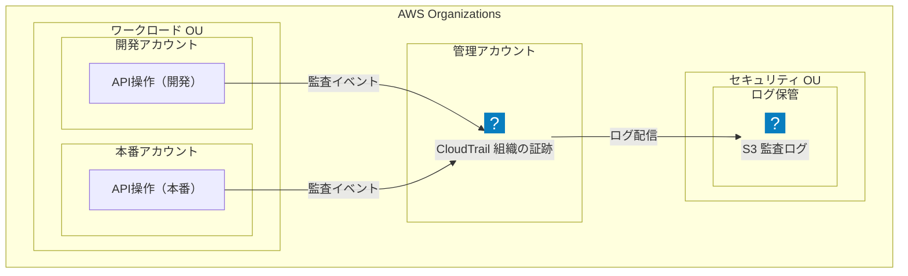
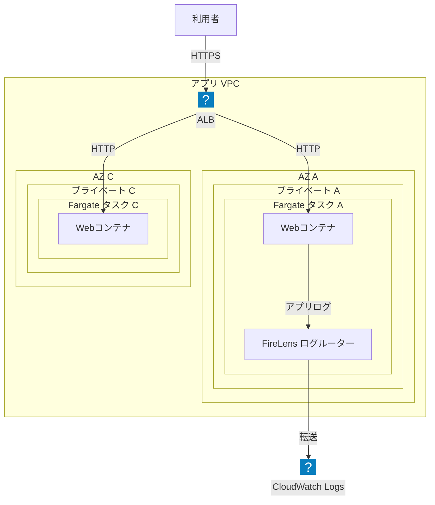

# Mermaidで描くAWS構成図

AWSの構成図で、アカウントやAZの境界と、リクエストやログの経路を示すサンプルです。

## マルチアカウント構成

開発・本番の監査イベントを、CloudTrailの組織の証跡で収集します。監査ログはセキュリティOUのログ保管アカウントにあるS3へ配信します。

## ECSコンテナ構成

ALBは2つのAZにあるECSタスクにリクエストを振り分けます。FireLensはコンテナのログをCloudWatch Logsへ転送します。図ではAZ Aのログ経路を示します。

