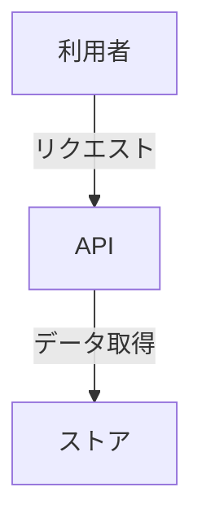
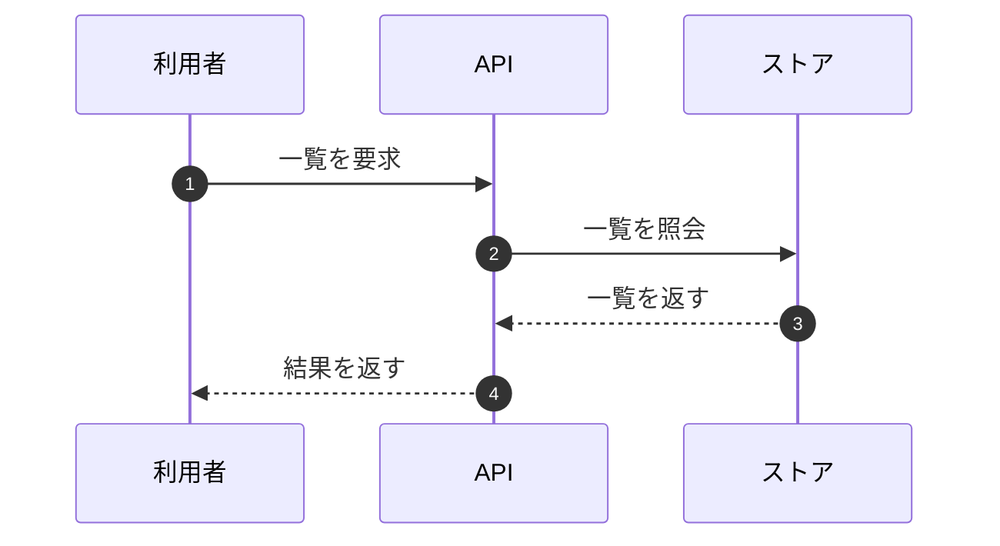
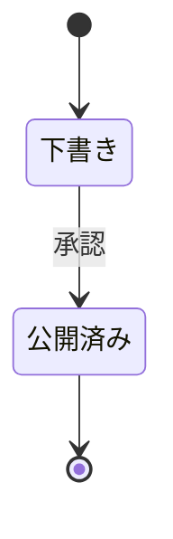
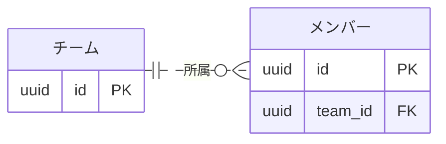
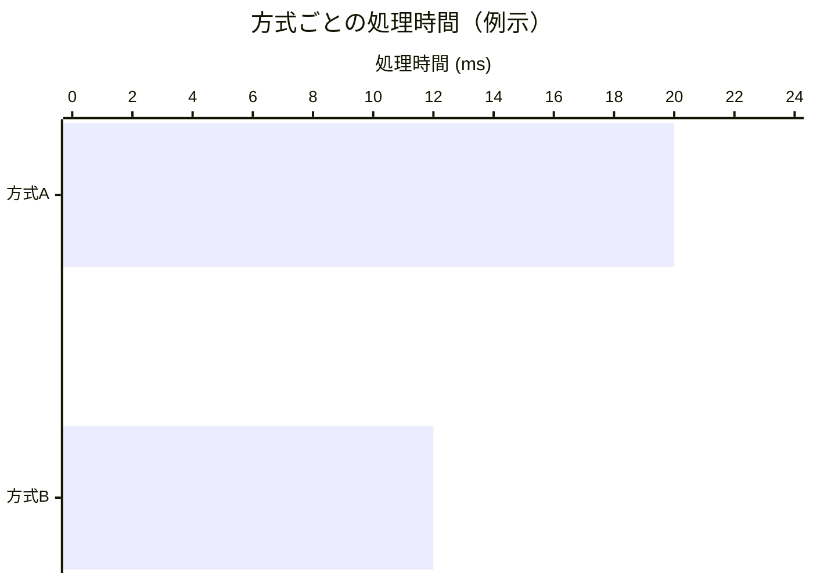
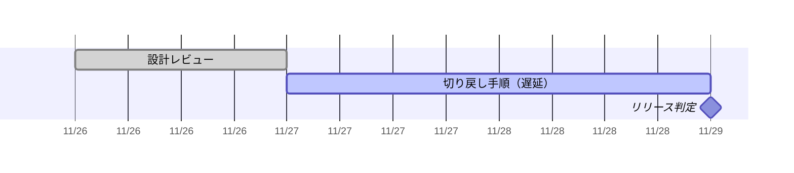

# MermaidとMarkdownで書く技術資料

## フロー図



## シーケンス図



## 状態遷移図



## ER図



## 数値グラフ



## タイムライン

**タイムライン**

| 日付 | 出来事 | 補足 |
| --- | --- | --- |
| 1日目 | 検証環境で試す | |
| 2日目 | 段階的に切り替える | 旧構成へ戻せる状態を保つ |

## ファイル構成

**ディレクトリツリー**

- `kh-html-explainer/`
  - `SKILL.md` — Codexが読む指示
  - `scripts/`
    - `render.mjs` — 原稿をHTMLに変換
  - `dist/`
    - `render.mjs` — 同梱の実行ファイル

## 警告の囲み

> **警告 — 切り替えを中断する条件**
>
> エラー率が基準を超えたら、切り替えを止めて元の設定に戻す。

## 変更の表示

```diff
--- a/retry.conf
+++ b/retry.conf
@@ -1 +1 @@
-retry_count = 1
+retry_count = 3
```

## 確認事項

> **確認事項**
>
> どの構成で進めますか？
>
> 影響範囲を確認してから1つ選んでください。
>
> 1. 既存環境で検証する
> 2. 検証環境を追加する

## ガントの遅延表示


